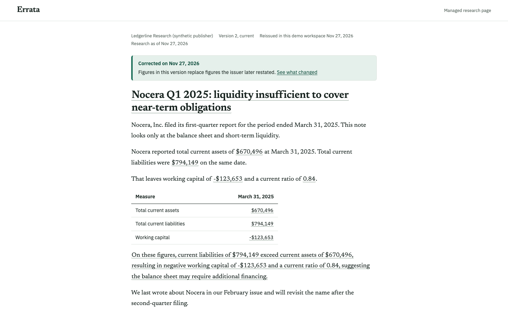

# Errata

When financial facts change, fix every report that depended on them.

Errata is a correction desk for financial research publishers. It keeps a record of which filing figures each published note relies on. When an issuer says its earlier statements should no longer be relied upon, Errata warns readers of every affected note straight away. When restated figures arrive, it prepares a corrected version, checked figure by figure against the amended filing, for an editor to approve and reissue. Four Mozaik agents do the reading, proposing, checking and drafting. Code enforces the evidence rules, and a person approves what gets published.

- Hosted demo: https://errata-smoky.vercel.app
- Agent runtime API: https://errata-api.158.220.85.120.sslip.io/api/v1/ready

## The case it is built around

Nocera, Inc. (CIK 1756180) is a real filer. The research note in the demo is synthetic, but every figure in it comes from a public SEC filing that was available on the note's date.

| Date | Public filing | What it says |
| --- | --- | --- |
| May 15, 2025 | [10-Q for Q1 2025](https://www.sec.gov/Archives/edgar/data/1756180/000168316825003734/nocera_i10q-33125.htm), accession 0001683168-25-003734 | Total current assets $1,275,416, total current liabilities $706,384 |
| May 20, 2025 | Synthetic note by "Ledgerline Research" (fictional) | Working capital $569,032, current ratio 1.81, "liquidity covers near-term obligations" |
| Aug 17, 2026 | [8-K Item 4.02](https://www.sec.gov/Archives/edgar/data/1756180/000168316826006537/nocera_8k.htm), accession 0001683168-26-006537 | FY2024, FY2025 and the quarters ended March 31, June 30 and September 30, 2025 should no longer be relied upon |
| Aug 28, 2026 | [10-K/A No. 2](https://www.sec.gov/Archives/edgar/data/1756180/000168316826006788/nocera_i10ka2-123125.htm), accession 0001683168-26-006788 | Q1 2025 restated: current assets $670,496, current liabilities $794,149 |

For eleven days, readers of that note needed a warning but no corrected figures existed. After the amendment, working capital is -$123,653 and the current ratio is 0.84, so the note's conclusion no longer holds. Errata handles both stages.

The repository also replays two more real restatements. The Joint Corp. restated current assets but not current liabilities, so one figure must be verified as unchanged rather than replaced. Xencor tagged its restatement in inline XBRL and reports in thousands.

## Try it

To see a finished correction without waiting for the agents, open https://errata-smoky.vercel.app/demo and choose **Open the recorded run**. It is the live Nocera run described under Results, kept read only, with every loop linked to its Mozaik Cloud session.

To run the agents yourself:

1. Open https://errata-smoky.vercel.app/demo and start the Nocera workspace. It is private to your browser and expires after a day.
2. Open the Nocera note and select a figure. The panel re-reads the cited cell from the stored filing and links to sec.gov.
3. Press **Play next disclosure** to release the 8-K on the replay clock. The Filing Monitor proposes which periods are affected. The Financial Verifier reads the notice itself and confirms them. The note then gets a warning on its public page while the Joint Corp. note stays clear. The roundup that only mentions Nocera goes under review until the agents establish that it cites no figures.
4. Press it again to release the 10-K/A. The Impact Analyst proposes restated figures. The verifier finds each one in the filing independently, and working capital and the ratio are recomputed in code. The Publication Editor drafts the corrected note and notice, and the verifier checks the rewritten conclusions against the figures.
5. Open **Review correction**, approve the exact draft, then reissue. Version 1 stays readable with its warning, version 2 becomes current, a correction notice is published, and the synthetic recipients get it in a simulated inbox. Exports are available as PDF, DOCX and Markdown.

The **Agent runtime** page shows every Mozaik loop on a shared time axis, the overlap between loops, challenges, stale results that were rejected, and a link to each loop's live session in Mozaik Cloud.




Other scenarios on the demo page replay the same filings with labelled fault injection. In one, new evidence lands while agents are working. In another, a bad proposal arrives and a check times out. The Joint Corp. and Xencor cases also have their own scenarios.

**Hosted demo speed.** The hosted runtime uses Groq's free tier, which allows 8,000 tokens per minute and per request. Agent calls wait whenever Groq asks them to, so a full Nocera correction takes tens of minutes rather than a few. With a paid provider key the same code runs at normal speed.

## Run it locally

Requirements: Node 24, pnpm 12 (via Corepack) and Docker.

```bash
cp .env.example .env            # add GROQ_API_KEY (or another provider key; see the file)
pnpm install
docker compose up -d db
pnpm --filter @errata/runtime dev   # API and agent runtime on :4000, runs migrations
pnpm --filter @errata/web dev       # web app on http://localhost:3000
```

To run the whole stack in containers instead:

```bash
cp .env.example .env
docker compose up --build       # Postgres, runtime and web; open http://localhost:3000
```

Mozaik Cloud telemetry is optional. Run `npx @mozaik-ai/cloud-sdk pair` once, or set `MOZAIK_API_KEY`. Without it the agents still run, just without cloud sessions.

### Command line

```bash
pnpm errata verify-sources                      # re-hash every committed filing snapshot
pnpm errata verify-sources --live               # re-download each from sec.gov and compare (needs SEC_USER_AGENT)
pnpm errata replay --scenario nocera-q1-repair --approve
pnpm errata evaluate --scenario nocera-q1-repair --runs 1
pnpm errata inspect-run --workspace <slug>
```

`replay --approve` runs live agents and then acts as a clearly labelled synthetic CLI editor to approve and reissue a ready draft. `evaluate` reads the manual ground truth in `datasets/evaluation` only after a run has finished, and writes its scores to `evaluation/results`.

### Tests

```bash
pnpm lint                               # Biome
pnpm --filter @errata/runtime test      # parsers, formulas, provider errors and retries, context budget, filing hash
pnpm test:integration                   # the full correction loop through the domain guards, against Postgres
pnpm test:e2e                           # Playwright: demo, evidence, approve and reissue, roles, isolation, phone layout
```

CI runs lint, typechecks, all three test suites, both production builds and the snapshot check on every push.

## How it works

```
SEC filings (verified snapshots or live EDGAR)
  -> ingestion: inline XBRL facts + HTML statement tables, each fact with a re-readable locator
  -> Postgres: evidence, claims, dependency graph, cases, proposals, attestations, versions, events
  -> committed domain events -> Mozaik runtime (one per workspace) -> four agents react
  -> agents call tools -> tools call domain functions -> transactional guards decide what is recorded
  -> SSE to the web app; public pages read only published versions
```

**What the agents do, and what code does.** Agents read filings, propose scope, propose replacements, check each other and draft text. They cannot publish, verify their own work, cite evidence that is not public at the replay clock, or type a financial figure into a draft. Code decides propagation through the claim graph, re-reads every cited table cell from the stored filing bytes, computes derived figures exactly, and checks that each displayed figure is tied to verified evidence. A person approves one exact draft, and reissuing re-checks everything in a single transaction.

**How Errata uses Mozaik** (`@mozaik-ai/core` 4.2.0, which has the same code as 6.0.0):

| Mozaik feature | Where | What it does here |
| --- | --- | --- |
| `defineRuntime` with a typed `RuntimeState` | `apps/runtime/src/agents/host.ts` | One runtime per workspace. The shared state holds the replay clock, each case's evidence revision and status, and the work in progress that every agent sees. |
| `createAgent`, `createHuman` | `host.ts`, `prompts.ts` | Filing Monitor, Impact Analyst, Financial Verifier and Publication Editor, plus an observer and a human editor participant. |
| `SemanticEvent` and `sendEvent` | `host.ts` | Every committed domain event (filing discovered, scope proposed, claim verified, challenge raised) enters the native bus. |
| `SituationSpecification` and situation handlers | `host.ts` | Each agent's handler decides on its own whether an event needs work. There is no central A then B then C script. |
| `runLoop` | `host.ts` | Each piece of work is its own native loop with a fresh context. Loops for different agents run at the same time. |
| `InterceptionHandler` | `host.ts` | Stops a loop when its case moves to newer evidence, enforces the tool-call budget, keeps each request under the provider's size limit, and sends one reminder when a loop tries to finish without making the write its task exists for. |
| `Tool` | `apps/runtime/src/agents/tools.ts` | Each task gets only the tools it needs. Every call is recorded with the evidence it touched. |
| `OpenAIChatCompletions`, `supportedModels`, `Endpoint` | `apps/runtime/src/agents/model.ts` | Groq is registered as a native model entry that uses the SDK's own Chat Completions mapper. Only the HTTP client is ours, so a stalled request is aborted after two minutes instead of the OpenAI default of ten. A wrapper around Mozaik's own runner adds concurrency limits, deadlines, rate-limit waits and retries. |
| Mozaik Cloud | built into `runLoop` | Every loop streams to app.jigjoy.ai, and the session link is stored on the agent run. |

**Checks between agents.**

- A scope proposal is confirmed only when a different agent cites the same periods from its own read of the notice.
- A replacement is verified only when the verifier read the cited cell itself in its own loop, the cell re-reads to the same value from the stored bytes, and the identity, period, column and value all match.
- Rejections open challenges, which send the work back to the proposer.
- The verifier gets two automatic checks of each proposal. If both end without a verdict, the proposal stays unverified and blocks the draft. An editor can then ask for one more independent check, and that request is recorded with the editor's name.
- A corrected draft is blocked until the verifier confirms that every rewritten conclusion is true on the corrected figures.
- When the evidence revision advances, work started on the old one is stopped by interception and rejected at commit.

## Financial data rules

- Every filing is stored as the bytes sec.gov served, with SHA-256 hashes in `datasets/provenance.json`. sec.gov's CDN appends a different bot-detection script tag to each download, so the filing hash is computed with that one tag removed. `verify-sources --live` confirms that all ten snapshots match what SEC serves today.
- A filing becomes visible to agents only after its SEC acceptance time on the replay clock. This is enforced in the data access layer, not only in prompts.
- Facts keep their issuer, concept, period, dimensions, unit, scale and column (as reported, adjustment, as restated). Amounts are exact decimals, and nothing is computed with floating point.
- Derived figures come from a restricted formula tree, evaluated in code with 40-digit precision. Division by zero is reported as undefined, never as a number.
- Draft text cannot contain typed figures. Editors write `{{claim:<id>}}`, and code inserts the verified value.
- Public pages, notices and exports say that the research is synthetic and that nothing is financial advice.

## Results

Every number below comes from a live run on Groq `openai/gpt-oss-120b` through `@mozaik-ai/core` 4.2.0, scored by `pnpm errata score` against the hand-written ground truth in `datasets/evaluation`. The raw records are in `evaluation/results`.

**Nocera repair, workspace `nocera-av6gcl8`** (`evaluation/results/nocera-q1-repair-nocera-av6gcl8.json`). This run is also on the hosted demo page as the read-only recorded run.

| Measure | Result |
| --- | --- |
| Non-reliance scope | Matched: FY2024, Q1 to Q3 2025 and FY2025 |
| Affected claims found | 9 of 9, no false positives |
| Replacements verified | 7 of 7 correct (4 restated figures, 3 recomputed in code) |
| Roundup that only mentions Nocera | Correctly cleared as unaffected |
| Warnings on unaffected notes | None |
| Figures in the reissued note tied to verified evidence | 14 of 14 |
| Agent loops | 32, with 42 overlapping pairs (6,252 s of overlap) |
| Challenges between agents | 2, both resolved |
| Tokens | 288,845 in, 15,569 out |
| 8-K released to reader warning | 76 s |

What this run needed besides the agents:

- The verifier twice ended a check of the current ratio without recording a verdict. An editor action asked for one more independent check, recorded under the synthetic CLI editor's name, and that check verified it.
- Eight loops failed. Four timed out on Groq requests that never answered, or while queued behind one. Four were cut off when the runtime was restarted to load fixes. One conclusion review was retried with `resume --retry-failed`.
- The build changed during the run. It started before and finished after the fixes for stalled requests, restart relaunch and the editor's response to blocked drafts, at commit `3925017`.
- Approval and reissue were done by the clearly labelled synthetic CLI editor, as `--approve` does.

The amendment-to-draft time for this run was 77 minutes. Most of it went to the ratio's missing verdict, about 30 minutes of stalled requests and the restarts, so it is not a measure of normal speed.

**Runs that did not finish.** `nocera-q1-repair-nocera-01k2xvc.json` stopped with 4 of 7 replacements verified, before the completion reminder and recheck existed. The Joint Corp. and Xencor files from the morning ended at the provider's daily token limit before any agent wrote a proposal, so they measure the quota, not the product.

## Limitations

- The research notes, publisher, analysts and recipients are synthetic. The SEC filings are real.
- Coverage is US domestic SEC filers with balance sheet tables or inline XBRL. Notes must be Markdown or plain text.
- Errata controls its own managed links. It cannot recall copies of a note that were forwarded elsewhere.
- Distribution is simulated: notices go to in-app inboxes and no email is sent.
- Agent quality depends on the model. On Groq's free tier, throughput is limited by the provider's per-minute budget, so loops overlap in time while their model calls wait their turn.
- No buyer interviews have been done yet. That publishers want this workflow is a hypothesis, not a finding.
- Nothing here is investment advice.

## Repository

```
apps/runtime   API, agent runtime, domain engine, CLI (TypeScript, Fastify, Drizzle, Postgres)
apps/web       Next.js app: landing, workspace, public pages
datasets       SEC filing snapshots and provenance, synthetic notes, scenarios, evaluation ground truth
e2e            Playwright browser tests
```
