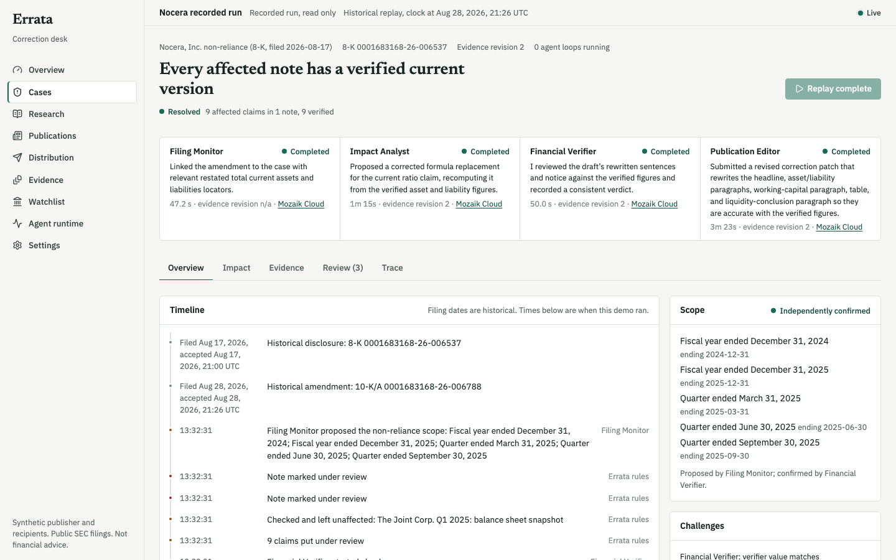
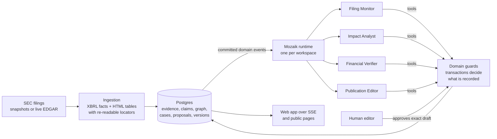
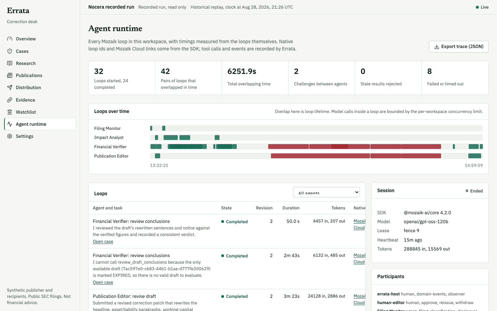

# Errata

**Errata is a correction desk for financial research publishers: when an SEC filing is restated, four concurrent AI agents find every published note that relied on it, warn readers, and draft a figure-by-figure verified correction for an editor to approve.**

[](https://github.com/winsznx/errata/actions/workflows/ci.yml)
[](LICENSE)


Errata keeps a record of which filing figures each published research note relies on. When an issuer tells the SEC that earlier financial statements should no longer be relied upon, Errata puts a warning on every affected note within about a minute. When the amended filing arrives, a Filing Monitor, Impact Analyst, Financial Verifier and Publication Editor, running as concurrent Mozaik agents, propose the restated figures, check each other's work against the filing itself, and draft a corrected version with a correction notice. Code enforces the evidence rules, and a person approves the exact draft that gets published.

- **Hosted demo:** https://errata-smoky.vercel.app (open `/demo`, then **Open the recorded run** to see a finished correction without waiting for the agents)
- **Demo video (3.5 min, narrated):** https://youtu.be/_-JYhg8Dt-w
- **Agent runtime API:** https://errata-api.158.220.85.120.sslip.io/api/v1/ready



## What it is

- **Claim graph.** Every figure and conclusion in a published note is a claim tied to the exact filing cell it came from, with formulas for derived figures such as working capital.
- **Four Mozaik agents.** Filing Monitor, Impact Analyst, Financial Verifier and Publication Editor, each reacting to events on its own in one Mozaik runtime per workspace.
- **Evidence engine.** SEC filings stored as exact bytes with SHA-256 hashes, inline XBRL and HTML table parsing, re-readable locators, exact decimal arithmetic.
- **Editorial workflow.** Reader warnings, versioned reissue, correction notices, simulated delivery to subscribers, and PDF, DOCX and Markdown exports.
- **Replay and live modes.** Historical replay of real restatements by Nocera, The Joint Corp. and Xencor, and a live EDGAR monitor for any issuer by CIK.

## The problem it solves

1. Restatements invalidate published research quietly. A note that cited the original figures stays online, and readers have no way to know.
2. Between the non-reliance notice and the amended filing there can be days or weeks when readers need a warning but no corrected figures exist yet.
3. Finding every affected sentence, table cell and conclusion across a publisher's archive is manual, slow and easy to get wrong.
4. A correction is only as good as its figures. Each replacement has to be checked against the amended filing, with the right period, column and scale.

Errata tracks the dependency from every published claim to its source figure, so it can warn readers the moment a filing is disowned and rebuild the note from verified figures when the restatement arrives.

### The case it is built around

Nocera, Inc. (CIK 1756180) is a real filer. The research note in the demo is synthetic, but every figure in it comes from a public SEC filing that was available on the note's date.

| Date | Public filing | What it says |
| --- | --- | --- |
| May 15, 2025 | [10-Q for Q1 2025](https://www.sec.gov/Archives/edgar/data/1756180/000168316825003734/nocera_i10q-33125.htm), accession 0001683168-25-003734 | Total current assets $1,275,416, total current liabilities $706,384 |
| May 20, 2025 | Synthetic note by "Ledgerline Research" (fictional) | Working capital $569,032, current ratio 1.81, "liquidity covers near-term obligations" |
| Aug 17, 2026 | [8-K Item 4.02](https://www.sec.gov/Archives/edgar/data/1756180/000168316826006537/nocera_8k.htm), accession 0001683168-26-006537 | FY2024, FY2025 and the quarters ended March 31, June 30 and September 30, 2025 should no longer be relied upon |
| Aug 28, 2026 | [10-K/A No. 2](https://www.sec.gov/Archives/edgar/data/1756180/000168316826006788/nocera_i10ka2-123125.htm), accession 0001683168-26-006788 | Q1 2025 restated: current assets $670,496, current liabilities $794,149 |

For eleven days, readers of that note needed a warning but no corrected figures existed. After the amendment, working capital is -$123,653 and the current ratio is 0.84, so the note's conclusion no longer holds. Errata handles both stages. The Joint Corp. restated current assets but not current liabilities, so one figure must be verified as unchanged rather than replaced. Xencor tagged its restatement in inline XBRL and reports in thousands.

## How it works



1. A filing becomes public on the replay clock, or arrives from the live EDGAR monitor, and is stored with its hash.
2. The Filing Monitor reads the 8-K Item 4.02 and proposes which periods are affected. The Financial Verifier reads the notice itself and confirms the scope only if its own periods match.
3. Code walks the claim graph and puts every dependent note under warning. Notes that only mention the issuer go under review until the Impact Analyst shows they rely on no figures.
4. When the amendment is linked, the case moves to a new evidence revision. Work still running on the old revision is stopped by interception and rejected at commit.
5. The Impact Analyst proposes restated figures and formula replacements. The Financial Verifier finds each figure in the filing on its own and submits what it read. Code compares, re-reads the cited cell from the stored bytes, and recomputes derived figures exactly.
6. The Publication Editor drafts the corrected note and notice using placeholders, never typed numbers. The verifier checks every rewritten conclusion against the corrected figures.
7. A human approves one exact draft. Reissue re-checks everything in one transaction, keeps version 1 readable with its warning, publishes version 2 and the notice, and queues simulated delivery.

## Key features

| Area | Capability |
| --- | --- |
| Concurrency | Four Mozaik agents in one runtime per workspace, each loop a separate `runLoop`, overlapping in time; 32 loops with 42 overlapping pairs in the recorded run |
| Coordination | No central script: each agent's situation handler reacts to committed domain events on the Mozaik bus |
| Independent checks | A replacement counts only when a different agent read the cited cell itself in its own loop and the value, period, column and scale match |
| Stale work | Interception stops loops on outdated evidence; commits from them are rejected |
| Challenges | Rejections open challenges that go back to the proposer; inconsistent conclusions go back to the editor |
| Evidence | Exact filing bytes with SHA-256, locators that re-read the cell, links to the public sec.gov copy |
| Numbers | Exact decimals, a restricted formula engine, no floating point, no typed figures in drafts |
| Publishing | Versioned reissue, correction notices, warnings on old versions, PDF, DOCX and Markdown exports |
| Observability | Agent runtime page with every loop on one time axis, overlap, challenges, failures, tokens, and each loop's Mozaik Cloud session |
| Recovery | Interrupted loops relaunch after a restart, stalled model requests are aborted and retried, humans can request a recheck or retry |
| Access | Private demo workspaces per browser, role-checked actions, idempotent commands, read-only recorded runs |



## Verified results

Every number below comes from a live run on Groq `openai/gpt-oss-120b` through `@mozaik-ai/core` 4.2.0, scored by `pnpm errata score --workspace <slug>` against the hand-written ground truth in `datasets/evaluation`, which agents never see. The raw records are in [`evaluation/results`](evaluation/results).

**Nocera repair, workspace `nocera-av6gcl8`** ([record](evaluation/results/nocera-q1-repair-nocera-av6gcl8.json)). This is the read-only recorded run on the hosted demo page.

| Measure | Result |
| --- | --- |
| Non-reliance scope | Matched: FY2024, Q1 to Q3 2025 and FY2025 |
| Affected claims found | 9 of 9, no false positives |
| Replacements verified | 7 of 7 correct (4 restated figures, 3 recomputed in code) |
| Roundup that only mentions Nocera | Correctly cleared as unaffected |
| Warnings on unaffected notes | None |
| Figures in the reissued note tied to verified evidence | 14 of 14 |
| Agent loops | 32, with 42 overlapping pairs (6,252 s of overlap) |
| Challenges between agents | 2, both resolved |
| Tokens | 288,845 in, 15,569 out |
| 8-K released to reader warning | 76 s |

What this run needed besides the agents:

- The verifier twice ended a check of the current ratio without recording a verdict. An editor action asked for one more independent check, recorded under the synthetic CLI editor's name, and that check verified it.
- Eight loops failed. Four timed out on Groq requests that never answered, or while queued behind one. Four were cut off when the runtime was restarted to load fixes. One conclusion review was retried with `resume --retry-failed`.
- The build changed during the run. It started before and finished after the fixes for stalled requests, restart relaunch and the editor's response to blocked drafts, at commit `3925017`.
- Approval and reissue were done by the clearly labelled synthetic CLI editor, as `--approve` does.

The amendment-to-draft time for this run was 77 minutes. Most of it went to the ratio's missing verdict, about 30 minutes of stalled requests and the restarts, so it is not a measure of normal speed.

**Nocera with new evidence mid-run, workspace `nocera-xwn01dk`** ([record](evaluation/results/nocera-q1-stale-evidence-nocera-xwn01dk.json)). A labelled scheduling control holds one of the Impact Analyst's writes on evidence revision 1 until the 10-K/A arrives. In the run, the Filing Monitor linked the 10-K/A at 15:08:44 UTC and the case moved to revision 2. In the same second, the held write was rejected at commit and interception stopped the analyst's loop. The analyst then redid the work on revision 2.

| Measure | Result |
| --- | --- |
| Non-reliance scope | Matched |
| Affected claims found | 9 of 9, no false positives |
| Stale results rejected | 2 |
| Replacements verified | 6 of 7 |
| Challenges between agents | 3 |
| Roundup that only mentions Nocera | Correctly cleared as unaffected |
| Warnings on unaffected notes | None |
| Agent loops | 23, with 32 overlapping pairs |
| Tokens | 230,776 in, 10,118 out |
| 8-K released to reader warning | 57 s |

This run did not reach reissue, and the reason is worth reading. For the table's working capital the Impact Analyst proposed the correct -$123,653, computed in code, three times. The Financial Verifier rejected it each time: once because it mis-transcribed the value, which code caught, and twice because it compared the result with the original $569,032 printed in the note instead of letting code compare it with the proposal. The case stopped in review with no wrong figure published, and the run was resumed once with `--retry-failed` after the first key hit Groq's daily limit. The verify instruction for formulas now says that the printed figure is expected to differ (commit `e45e668`); that change has not been re-run yet.

**Nocera with a bad proposal and a failed check, workspace `nocera-vc4626o`** ([record](evaluation/results/nocera-q1-conflict-2026-11-27T21-55-10-069Z.json)). Labelled fault injection proposes a wrong figure and forces one verifier call to time out. At 21:09:53 UTC the injected proposal put total current assets at 8,269,342. The Financial Verifier read 670,496 from the filing itself, so code rejected the proposal and opened a challenge. The Impact Analyst then proposed 670,496, which was verified, and the challenge was resolved. The forced timeout was retried and recovered.

| Measure | Result |
| --- | --- |
| Non-reliance scope | Matched |
| Affected claims found | 9 of 9, no false positives |
| Injected wrong figure | Rejected by the verifier's own read of the filing |
| Replacements verified | 6 of 7 |
| Agent loops | 17, with 31 overlapping pairs (5,754 s of overlap) |
| Tokens | 164,229 in, 7,190 out |
| 8-K released to reader warning | 57 s |

This run did not reach reissue either: the check of the table's working capital, correctly proposed as -$123,653, timed out waiting on the provider and the run reached its time limit.

Earlier files in `evaluation/results` are kept as recorded. `nocera-q1-repair-nocera-01k2xvc.json` stopped with 4 of 7 replacements verified, before the completion reminder and recheck existed. The Joint Corp. and Xencor files ended at the provider's daily token limit before any agent wrote a proposal, so they measure the quota rather than the product.


## How it is built

- **Agents propose, code decides.** Every agent capability is a tool that calls a domain function, and the domain function enforces the rule inside a transaction. Prompts are never the only guard.
- **No self-verification.** The agent that proposed a value can never verify it, and a verification counts only if the verifier read the cited cell in its own loop.
- **Evidence revisions.** Each case carries an evidence revision; work started on an older one is stopped by interception and rejected at commit.
- **Exact numbers.** Decimal strings end to end, a restricted formula tree evaluated with 40-digit precision, placeholders instead of typed figures in drafts.
- **No lookahead.** A filing becomes visible to agents only after its SEC acceptance time on the replay clock, enforced in the data access layer.
- **Honest records.** Results come from live runs scored against hand-written ground truth; failures and human interventions are recorded and reported.

| Milestone | State |
| --- | --- |
| Claim graph, evidence engine, exact formulas | Built |
| Four concurrent Mozaik agents with interception, challenges and independent verification | Built |
| Warnings, versioned reissue, correction notices, simulated delivery, exports | Built |
| Historical replay for three real restatements, live EDGAR monitor | Built |
| Agent runtime observability, recorded runs, evaluation harness | Built |
| Reopening a resolved case when new evidence arrives | Next |
| Withdrawing a note from the web app (available in the API today) | Next |
| Retention cleanup of expired demo workspaces | Next |
| Email delivery of correction notices | Planned |

## Quick start

Requirements: Node 24, pnpm 12 (through Corepack) and Docker. A Groq API key runs the agents; everything else works without one.

```bash
git clone https://github.com/winsznx/errata.git
cd errata
cp .env.example .env                # add GROQ_API_KEY
pnpm install
docker compose up -d db
pnpm --filter @errata/runtime dev   # API and agent runtime on :4000, runs migrations
pnpm --filter @errata/web dev       # web app on http://localhost:3000
```

Open http://localhost:3000/demo, start the Nocera workspace, and press **Play next disclosure** twice. Mozaik Cloud telemetry is optional: run `npx @mozaik-ai/cloud-sdk pair` once, or set `MOZAIK_API_KEY`.

## Reproduce the results

1. Check the code: `pnpm lint && pnpm -r typecheck && pnpm --filter @errata/runtime test && pnpm test:integration && pnpm test:e2e`. None of these call a model provider.
2. Check the evidence: `pnpm errata verify-sources` re-hashes every committed filing snapshot, and `pnpm errata verify-sources --live` downloads each one from sec.gov again and compares (set `SEC_USER_AGENT` first).
3. Run a scenario with live agents and score it: `pnpm errata evaluate --scenario nocera-q1-repair --runs 1`. The record is written to `evaluation/results/`.
4. Inspect what the agents did: `pnpm errata inspect-run --workspace <slug>`, or open `/w/<slug>/runtime` in the web app.
5. If the provider's limits interrupt a run, finish it with `pnpm errata resume --workspace <slug> --approve --retry-failed`, then `pnpm errata score --workspace <slug>`.

On Groq's free tier a full Nocera run uses about 300k tokens, more than one day's free budget for one account.

## Run it anywhere

| Environment | How |
| --- | --- |
| Laptop | Quick start above |
| Docker | `cp .env.example .env && docker compose up --build`, then open http://localhost:3000 |
| Server or VPS | Build `apps/runtime/Dockerfile`, run it with Postgres 16 and the variables from `.env.example`; set `RESUME_INTERRUPTED_ON_BOOT=true` |
| Vercel | Deploy `apps/web` with `RUNTIME_INTERNAL_URL` and `NEXT_PUBLIC_EVENTS_ORIGIN` set to the runtime's public URL |

The hosted demo runs the web app on Vercel and the runtime with Postgres on a VPS behind Caddy.

## Command reference

| Command | What it does |
| --- | --- |
| `pnpm errata scenarios` | List replay scenarios |
| `pnpm errata verify-sources [--live]` | Re-hash filing snapshots, or compare them with sec.gov |
| `pnpm errata replay --scenario <id> [--approve]` | Run a scenario with live agents; `--approve` acts as a labelled synthetic CLI editor |
| `pnpm errata evaluate --scenario <id> [--runs <n>]` | Run and score against ground truth |
| `pnpm errata score --workspace <slug>` | Score a finished workspace |
| `pnpm errata resume --workspace <slug> [--approve] [--recheck] [--retry-failed]` | Bring a workspace's runtime back and let pending work finish |
| `pnpm errata inspect-run --workspace <slug>` | Print agent runs, challenges and outcome |
| `pnpm errata export-workspace --workspace <slug> --out <file>` | Export one workspace and the filing keys it relies on |
| `pnpm errata import-workspace --file <file> [--reference]` | Import a workspace; `--reference` makes it a read-only recorded run |

The HTTP API lives under `/api/v1`: `/ready` reports database, model and Mozaik Cloud status, and `/workspaces/:id/...` serves cases, evidence, proposals, drafts, the runtime view and a server-sent event stream.

## Project structure

```
apps/runtime        API, Mozaik agent runtime, domain engine, CLI (TypeScript, Fastify, Drizzle, Postgres)
  src/agents        runtime host, agent prompts, tools, model wrapper, context budget
  src/domain        cases, claims, verification, publication, events, locators
  src/sources       SEC ingestion, filing hashes, live EDGAR monitor
  src/api           HTTP routes, auth, views
apps/web            Next.js app: landing, demo, workspace desk, agent runtime, public pages
datasets            SEC filing snapshots and provenance, synthetic notes, scenarios, evaluation ground truth
evaluation/results  Scored records of live runs
e2e                 Playwright browser tests
docs/screenshots    Screenshots of the recorded run
```

## Documentation

- [CONTRIBUTING.md](CONTRIBUTING.md): set up, checks to run, and what a good change looks like
- [SECURITY.md](SECURITY.md): how to report a vulnerability and how secrets are handled
- [CHANGELOG.md](CHANGELOG.md): release notes
- [`.env.example`](.env.example): every configuration variable with an explanation

## Contributing and security

Issues and pull requests are welcome; see [CONTRIBUTING.md](CONTRIBUTING.md) and the [code of conduct](CODE_OF_CONDUCT.md). Report vulnerabilities privately as described in [SECURITY.md](SECURITY.md).

The research notes, publisher and recipients in this repository are synthetic; the SEC filings are real public documents. Nothing here is investment advice.

## License

[MIT](LICENSE)
